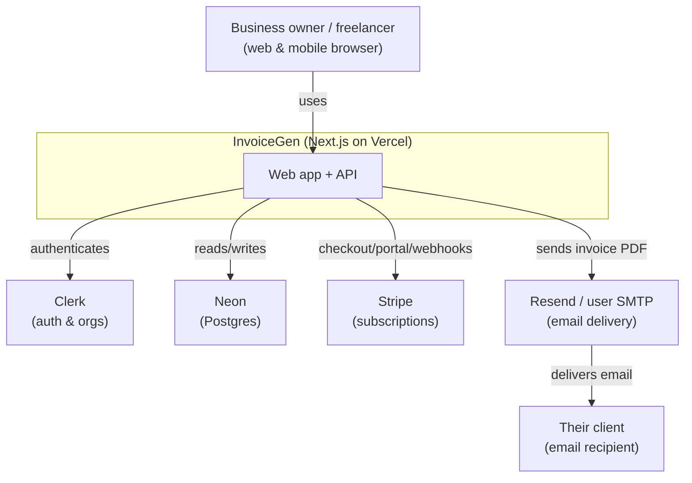
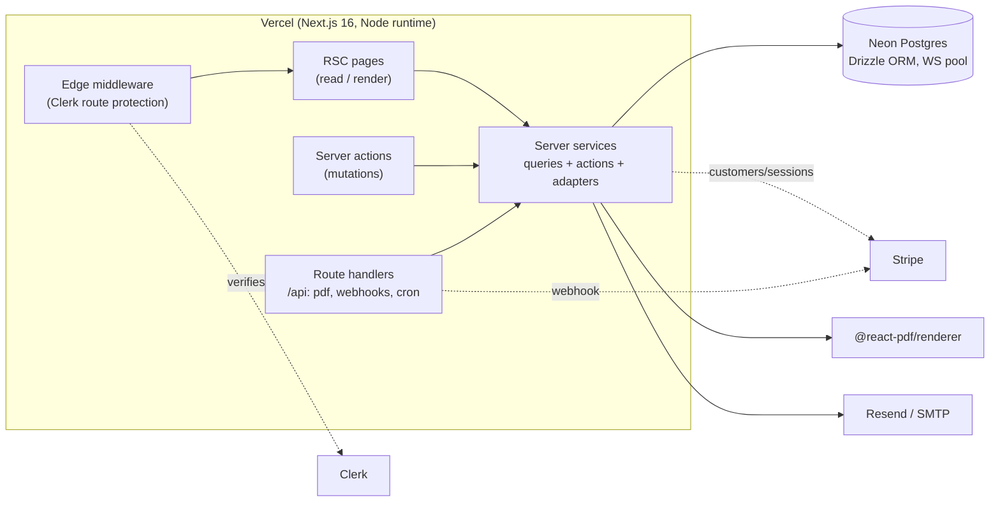
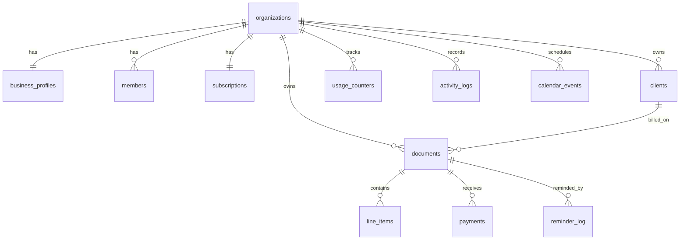
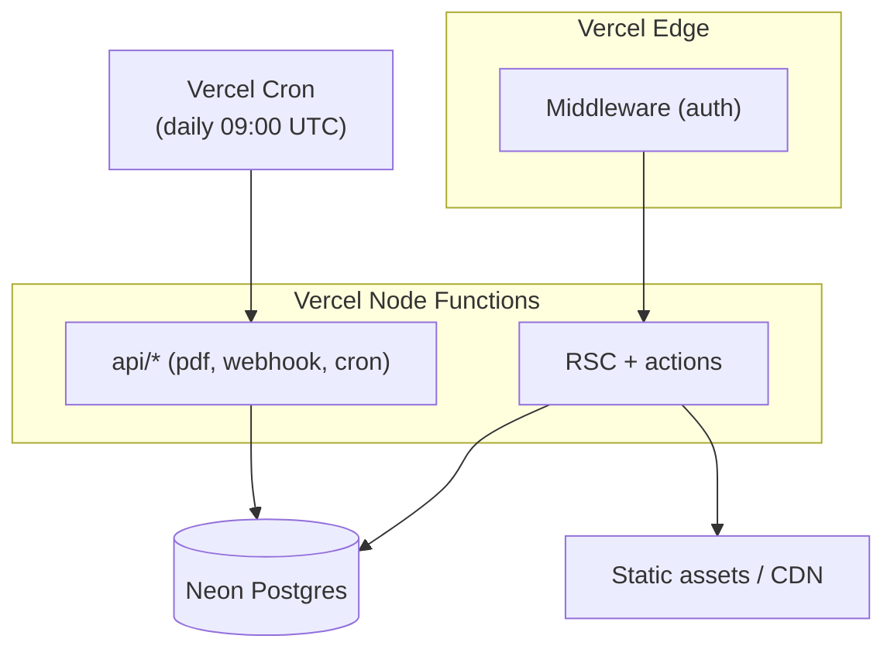

# InvoiceGen — High-Level Architecture

**Document:** MOU_System_High_Level_Architecture
**Product:** InvoiceGen — Invoice, Quote & Receipt SaaS
**Version:** 1.0 · **Date:** 2026-06-12 · **Status:** Baseline (as-built)
**Owner:** Engineering

---

## 1. Document control

| Version | Date | Author | Change |
| --- | --- | --- | --- |
| 1.0 | 2026-06-12 | Eng | As-built HLA for the MVP |

Companion docs: `MOU_System_Development_Plan.md`, `architecture-context.md`,
`code-standards.md`, `ui-context.md`.

---

## 2. Purpose & scope

This document describes the high-level architecture of InvoiceGen: its context,
containers, components, data model, technology choices, integrations, security,
and non-functional characteristics. It is the authoritative architectural
reference; implementation conventions live in `code-standards.md` and
`ai-workflow-rules.md`.

---

## 3. Architectural goals & principles

| Goal | Principle / how it's met |
| --- | --- |
| Correctness of money & numbering | Single calc engine; transactional, gap-free numbering |
| Tenant isolation | Every row carries `orgId`; all access scoped to context |
| Fidelity (preview == PDF) | One `DocumentView` feeds all renderers |
| Serverless simplicity | Stateless app, serverless Postgres, cron via platform |
| Graceful degradation | Typed env flags; app builds/runs without optional services |
| Type safety end-to-end | TS strict, Drizzle types, Zod validation at boundaries |
| Security by default | Edge auth, scoped queries, encrypted secrets, signed webhooks |
| Incremental extensibility | Clear layering: app → components/server → lib |

---

## 4. Context view (C4 Level 1)



---

## 5. Container view (C4 Level 2)



**Containers**
- **Edge middleware** — authenticates requests; defines public routes.
- **RSC pages** — read data via server queries and render UI.
- **Server actions** — validated, tenant-scoped mutations.
- **Route handlers** — PDF download, Stripe webhook, reminders cron.
- **Server services** (`src/server/*`) — queries, actions, and integration
  adapters (DB, PDF, email, billing).
- **Neon Postgres** — durable store accessed through Drizzle (WebSocket pool for
  real transactions).

---

## 6. Technology stack & rationale

| Concern | Technology | Rationale |
| --- | --- | --- |
| Framework | Next.js 16 (App Router, RSC) | Unified marketing + app, server actions, Vercel-native |
| Language | TypeScript (strict) | End-to-end type safety |
| Styling | Tailwind CSS v4 + Radix + cva | CSS-first theming, accessible primitives |
| ORM/DB | Drizzle + Neon Postgres | Type-safe SQL, serverless driver, real transactions |
| Auth | Clerk | Multi-user/org seats, social + email, hosted UI |
| Billing | Stripe | Subscriptions, checkout, portal, webhooks |
| PDF | @react-pdf/renderer | Server-rendered, pixel-controlled A4 output |
| Email | Resend + Nodemailer | Platform default + user-owned SMTP |
| Charts | Recharts | Simple, themeable dashboard charts |
| Validation | Zod | Boundary validation, inferred types |
| UX | Sonner toasts, date-fns | Feedback, date handling |

Notable decisions: **Neon WebSocket pool** (not HTTP driver) to enable
transactions for atomic numbering; **lazy DB proxy** so builds don't require a
live database; **personal-org tenancy** so solo users need no manual org setup.

---

## 7. Component view (server services)

```
server/
├── db/            schema.ts (17 tables), index.ts (lazy proxy), seed.ts
├── auth/          context.ts  → getOrgContext / requireOrgContext (tenant + plan)
├── activity.ts    logActivity (audit trail)
├── billing/       usage.ts (limits/usage), stripe.ts (client), actions.ts (checkout/portal)
├── clients/       queries.ts, actions.ts
├── documents/     queries.ts, actions.ts, numbering.ts, send.ts
├── payments/      actions.ts
├── settings/      actions.ts (business/email/reminders)
├── email/         transport.ts (SMTP/Resend), templates.ts
├── pdf/           document-pdf.tsx, render.tsx
├── dashboard/     queries.ts (metrics, revenue series, payments)
└── onboarding/    actions.ts
```

Each domain follows **queries (read, `server-only`) + actions (write,
`"use server"`)**, both depending on `db` and `auth/context`, with pure logic in
`src/lib/*` (`calc`, `money`, `plans`, `templates`, `document-view`, `crypto`,
`validators`, `format`).

---

## 8. Data architecture

### 8.1 Entity overview (selected)



### 8.2 Storage conventions
- **Identifiers:** UUID primary keys (`defaultRandom`).
- **Money:** `numeric(14,2)`; quantity `numeric(12,3)`; rates `numeric(5,2)`.
- **Timestamps:** `timestamptz`; calendar dates as `date` (YYYY-MM-DD).
- **JSONB:** party snapshots, tags, reminder schedule, template config, payloads.
- **Integrity:** `ON DELETE CASCADE` from `organizations` down; unique indexes on
  `(orgId, number)`, `(orgId, clerkUserId)`, `(orgId, periodStart)`,
  `(orgId, kind)` (email templates).

### 8.3 Numbering & snapshots
- Per-org counters on `business_profiles`; reserved atomically within the same
  transaction as document insert.
- `documents.fromSnapshot` / `billToSnapshot` freeze issuer/recipient details so
  historical documents are immutable to later profile/client edits.

---

## 9. Integration architecture

| Integration | Direction | Mechanism | Trust boundary |
| --- | --- | --- | --- |
| Clerk | App → Clerk | SDK + middleware; session in request | Verified at edge |
| Neon | App → DB | Drizzle over WS pool (TLS) | Connection string secret |
| Stripe (out) | App → Stripe | Checkout/Portal sessions | Server-side secret key |
| Stripe (in) | Stripe → App | `POST /api/webhooks/stripe` | HMAC signature verified |
| Email | App → Resend/SMTP | API key / SMTP creds (encrypted) | Per-org config |
| Cron | Scheduler → App | `GET /api/cron/reminders` | Bearer `CRON_SECRET` |

The **Stripe webhook is the single source of truth** for `organizations.plan`
and `subscriptions`. Email transport selects user SMTP when configured, else the
platform Resend default.

---

## 10. Security architecture

- **Authentication:** Clerk sessions enforced by edge middleware; protected
  routes require a valid session.
- **Authorization & isolation:** `requireOrgContext()` at every server entry
  point; all queries filtered by `orgId`; no client-supplied tenant ids trusted.
- **Secrets:** centralized in `src/lib/env.ts`; SMTP passwords encrypted at rest
  with AES-256-GCM (`APP_ENCRYPTION_KEY`); never logged.
- **Integrity:** Stripe signature verification; cron bearer token; Zod-validated
  inputs; parameterized SQL via Drizzle.
- **Auditability:** `activity_logs` captures key actions with actor + entity.
- **Data lifecycle:** cascade deletes enable clean tenant/data removal
  (GDPR-friendly); sequential numbering supports financial compliance.

---

## 11. Non-functional requirements

| Attribute | Target / approach |
| --- | --- |
| Performance | RSC streaming; indexed, projected, aggregate queries; pooled connections |
| Scalability | Stateless app (horizontal on Vercel); serverless Postgres; cron offloads batch work |
| Availability | Managed services (Vercel/Neon/Clerk/Stripe); graceful degradation when optional services absent |
| Reliability | Transactions for atomic invariants; idempotent webhook & reminder handling (`reminder_log`) |
| Security | See §10 |
| Maintainability | Strict layering, single calc engine, typed schema, documented conventions |
| Usability | Mobile-first, accessible, live preview, helpful empty/error states |
| Observability | Console error logging today; pluggable error tracking planned |
| Portability | Env-driven config; standard Postgres; no vendor lock beyond chosen SaaS |

---

## 12. Deployment architecture



- Single Vercel project; Node runtime pinned for PDF/webhook/cron.
- Cron schedule declared in `vercel.json` (`/api/cron/reminders`).
- Environments: Local → Preview → Production, each with its own Neon branch and
  service keys.

---

## 13. Architectural risks, assumptions & decisions

| Type | Item |
| --- | --- |
| Assumption | Operator supplies Clerk/Neon and optionally Stripe/Resend keys |
| Assumption | Single-region deployment is acceptable for MVP latency |
| Decision | Drizzle + Neon WS pool over Prisma/HTTP driver (transactions, cold-start) |
| Decision | Personal-org tenancy to remove solo-user onboarding friction |
| Decision | Lazy DB client to keep builds independent of live DB |
| Decision | Keep `middleware.ts` (Clerk convention) despite Next 16 `proxy.ts` rename |
| Risk | No automated tests yet (mitigated in Dev Plan Phase 10) |
| Risk | Logo currently a URL, not uploaded asset (future: object storage) |

---

## 14. Future architectural considerations

- **Recurring invoices**: scheduled generator job consuming
  `recurring_invoices.payload`, reusing the cron container.
- **End-customer online payments**: Stripe Checkout/Payment Links per invoice;
  reconcile via webhook into `payments`.
- **Object storage** (Cloudflare R2): public bucket for logos, private bucket for archived PDFs (`documents.pdfKey`).
- **Reporting service**: materialized views or a reporting read-model for the
  Business plan.
- **Observability**: structured logs + error tracking (Sentry) + uptime checks.
- **Multi-region / read replicas** if latency or scale demands grow.
- **Google Calendar sync** using reserved `calendar_events.googleEventId`.

---

## 15. Glossary

| Term | Meaning |
| --- | --- |
| Org / tenant | An `organizations` row; isolation boundary for all data |
| DocumentView | Normalized render model shared by preview, detail, and PDF |
| Snapshot | Frozen issuer/recipient details stored on a document |
| Plan | Subscription tier (free/growth/business) with limits & features |
| Usage counter | Monthly per-org metric used for limit enforcement |
